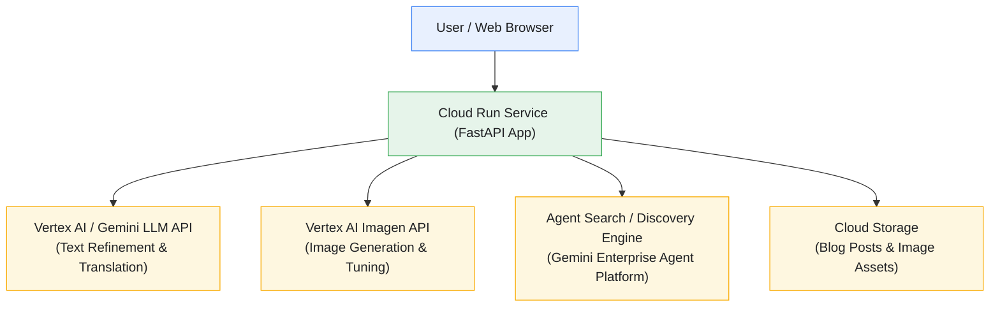

# 🌐 Gen Ai Mod App 📲

https://github.com/user-attachments/assets/44119e2f-ad16-4612-ac6c-6da97987a7cc

> 🎥 Watch **Gen Ai Mod App** in action!

> [!CAUTION]
> The Cloud Run deployment is currently unavailable because the Google Cloud project has exhausted its available credits. The project was previously deployed and tested successfully on Google Cloud Run.

---

## Table of Contents

- [Introduction](#introduction)
- [Architecture Diagram](#architecture-diagram)
- [Project Structure](#project-structure)
- [Features](#features)
- [Tech Stack](#tech-stack)
- [Application Workflow](#application-workflow)
- [Screenshots](#screenshots)
- [Generative AI Capabilities & Integration](#generative-ai-capabilities--integration)
- [AI-Assisted Development](#ai-assisted-development)
- [Google Skills Challenge Lab Reference](#google-skills-challenge-lab-reference)
- [Future Enhancements](#future-enhancements)
- [Resources](#resources)
- [Disclaimer](#disclaimer)
- [Contributing](#contributing)
- [License](#license)
- [Author](#author)

---

## Introduction

**Gen Ai Mod App** is a modernized web application project developed as part of my hands-on learning with Google Cloud's Generative AI tools, including Gemini models, Vertex AI Imagen, Agent Search (Gemini Enterprise Agent Platform), and Cloud Run.

The project explores how to modernize a traditional legacy website into a dynamic, AI-powered platform by integrating automated content generation, image editing and creation, instant language translation, text copy refinement, and conversational search capabilities over unstructured data like blog posts.

The repository includes a backend API built using FastAPI, Jinja templates for frontend rendering, modular routers for different AI functionalities, and containerization setup for seamless deployment on Google Cloud Run.

The project demonstrates practical concepts in website modernization, prompt engineering, multi-model AI integration, and cloud-native application deployment.

This repository documents my implementation and learning with Google Cloud Generative AI, including the application structure, supporting modules, dependencies, and related learning resources.

---

## Architecture Diagram

The following diagram illustrates the architecture of the application deployed on Google Cloud:



> [!NOTE]
> This diagram provides a high-level overview of the application components and their interactions across Google Cloud managed services.

### Architecture Overview

1. **Cloud Run Service (FastAPI App)**
   - Hosts the containerized Python FastAPI web application.
   - Manages HTTP routing, view dispatching, and API integrations.
  
2. **Vertex AI / Gemini LLM API**
   - Powers the text editing, translation, and copy refinement features.
   - Utilizes advanced Gemini models for contextual content transformation.
  
3. **Vertex AI Imagen API**
   - Handles image generation and tuning requests.
   - Allows users to generate and substitute visuals directly from the website UI.
  
4. **Agent Search (Gemini Enterprise Agent Platform)**
   - Provides semantic search and RAG capabilities over unstructured blog data imported from Cloud Storage.
  
5. **Cloud Storage**
   - Stores raw HTML/JSON blog post documents, static assets, and generated images.
  
---

## Project Structure

The repository organizes the source code into separate modules, templates, and backend routers.

```text
gen-ai-mod-app/
├── genai-website-mod-app/
│   ├── models/
│   │   └── data models used by the website application
│   ├── routers/
│   │   ├── hello.py
│   │   ├── vertex_imagen.py
│   │   ├── vertex_llm.py
│   │   ├── vertex_search.py
│   │   └── page_content_dispatch.py
│   ├── static/
│   │   ├── css, images, and JS assets
│   ├── templates/
│   │   └── Jinja templates for website pages
│   ├── utils/
│   │   ├── content_utils.py
│   │   ├── imagen.py
│   │   └── vertex_llm_utils.py
│   ├── views/
│   │   └── view implementations
│   │ 
│   ├── config.toml
│   ├── Dockerfile
│   ├── main.py
│   └── requirements.txt
│
├── .gitignore
├── CODE_OF_CONDUCT.md
├── CONTRIBUTING.md
├── LICENSE
└── README.md
```

> [!NOTE]
> This tree represents the main source files identified in the project. Refer to the repository for the complete file structure.

### Key Components

- **`main.py`** — Main FastAPI entrypoint to the website application.
- **`config.toml`** — Configuration file for application variables, project IDs, and model settings.
- **`Dockerfile`** — Configuration to build the website application container for Cloud Run.
- **`routers/`** — FastAPI API routers handling search, image generation, text translation, and refinement functionality.
- **`utils/`** — Utility modules implementing SDK calls for Gemini, Imagen, and content management.
- **`static/`** & **`templates/`** — Frontend assets and Jinja HTML templates powering the Cymbal Investments website UI.
- **`.gitignore`** — Excludes configured local, generated, and sensitive files from version control.
- **`CONTRIBUTING.md`, `CODE_OF_CONDUCT.md`, and `SECURITY.md`** — Describe contribution, community conduct, and security-reporting guidelines.

---

## Features

- **FastAPI Backend:** Built with a high-performance Python web framework for robust API and web page handling.
- **Cloud Run Deployment:** Fully containerized and deployed on Google Cloud's serverless container platform.
- **Agent Search Integration:** Embedded semantic search powered by the Gemini Enterprise Agent Platform to query unstructured blog documents.
- **AI-Powered Image Generation:** Integrated Vertex AI Imagen model allowing users to tune and generate new visual assets on the fly.
- **Inline Text Translation:** Instant webpage text translation into multiple languages using generative language models.
- **Copy Refinement:** Tone and style adjustments (e.g., formal and impactful) to improve website text content instantly.
- **Cloud Storage Persistence:** Stores and retrieves content and generated images dynamically using Google Cloud Storage buckets.
- **Logging & Observability:** Uses Google Cloud Logging and Logs Explorer to audit prompt executions and API requests.

> [!NOTE]
> The actual capabilities and execution behavior depend on valid GCP credentials, API enablement, and configuration settings.

---

## Tech Stack

| Technology | Purpose |
|---|---|
| **Python** | Primary programming language |
| **FastAPI** | Web framework for building APIs and handling application routes |
| **Google Cloud Run** | Scalable serverless container hosting platform |
| **Gemini Models & Vertex AI** | Text translation, content refinement, and generation |
| **Vertex AI Imagen** | AI-based image generation and tuning |
| **Agent Search / Discovery Engine** | Conversational search over unstructured data |
| **Google Cloud Storage** | Storing website content, blog posts, and generated images |
| **Docker** | Containerization of the web application |
| **Jinja / HTML / CSS / JS** | Frontend templates and static web assets |
| **Git & GitHub** | Version control and source code hosting |

> [!NOTE]
> The table describes the technologies and concepts reflected in the project implementation.

---

## Application Workflow

**Gen Ai Mod App** is structured around modern web routes and AI utility handlers.

### 1️⃣ Environment & Config Setup

- Configure project IDs, region settings, and data store identifiers in `config.toml`.
- Enable required GCP services including the Agent Platform API and Vertex AI.

### 2️⃣ Containerization & Deployment

- Build the container image using the provided `Dockerfile`.
- Deploy the service to Google Cloud Run with environment variables set for Vertex AI usage.

### 3️⃣ Conversational Search Integration

- Ingest blog post HTML data from Cloud Storage into a data store.
- Query unstructured knowledge using the Agent Search API to return AI summaries alongside source references.

### 4️⃣ Content Generation & Editing

- Access edit mode on website blog pages to modify text or visual assets.
- Trigger Imagen prompts to replace stock images with newly generated graphics.

### 5️⃣ Translation & Copy Refinement

- Select text paragraphs to translate into languages like French.
- Apply style prompts such as "formal impactful" to refine copywriting and replace text inline.

--- 

## Screenshots

This section showcases the **Gen Ai Mod App** user interface, search functionality, content editing, and Google Cloud configurations.

### GCP Console Dashboard


### Cloud Shell Terminal


### Google Cloud AI Applications Dashboard


### Agent Search Preview & Query Testing


### Modernized Website UI & Pages


### Blog Editor and AI Content Generation


### Project Source Code


### Google Cloud Monitoring & Logging


### Cloud Run Observability & Deployment Management


---

## Generative AI Capabilities & Integration

### Agent Search App

- Created via AI Applications / Discovery Engine.
- Indexes unstructured HTML documents from Cloud Storage to power semantic RAG search.

### Image Generation (Vertex AI Imagen)

- Invokes generative image models through the Vertex AI SDK.
- Translates descriptive user prompts into high-resolution visuals embedded directly into website pages.

### Text Translation & Refinement

- Uses Gemini models with structured prompt templates (`ai_translate_inline` and `ai_refine_text`).
- Returns clean, unquoted string outputs to ensure seamless inline website updates.

---

## AI-Assisted Development

AI tools can support the development and exploration of modernized web applications by helping explain unfamiliar code, investigate implementation issues, understand cloud architectures, and improve technical documentation.

During the development and learning process for Gen Ai Mod App, AI assistance may be used to support activities such as:

- Understanding FastAPI routing principles and Jinja template integration.
- Exploring Vertex AI SDK implementations for Gemini and Imagen.
- Configuring Discovery Engine data stores and Agent Search integrations.
- Investigating containerization best practices with Docker and Cloud Run.
- Reviewing cloud logging structures and prompt execution logs.
- Improving project documentation, code readability, and repository presentation.

AI-generated suggestions and code should be reviewed critically, verified against the actual implementation, and tested before being adopted.

---

## Google Skills Challenge Lab Reference

This project was developed after completing the following Google Cloud learning resources.

### Challenge Lab

**Modernize your Website with Generative AI on Google Cloud**

[Open the Google Skills lab](https://www.skills.google/paths/1282/course_templates/1097/labs/686300)

### Learning Context

The repository serves as a personal source-code project associated with this learning experience.

It provides a place to explore and document:

- Website modernization techniques using Generative AI.
- FastAPI backend development and routing.
- Google Cloud Run serverless deployment.
- Gemini Enterprise Agent Platform and Agent Search.
- Vertex AI Imagen image generation.
- Inline content translation and text copy refinement.

For official learning objectives, instructions, and environment setup requirements, refer to the Google Skills lab page linked above.

---

## Future Enhancements

The following ideas could be considered for future versions of **Gen Ai Mod App**:

- **Advanced Multi-Modal Editing:** Expand image tuning capabilities to support image-to-image style transfers.
- **User Authentication:** Add secure login workflows for content editors and administrators.
- **Automated Workflow Approvals:** Implement robust draft submission and review pipelines.
- **Multi-Language Expansion:** Support dynamic full-page translation for a wider array of global languages.
- **Enhanced Analytics:** Integrate Vertex AI Search analytics to track popular user queries.
- **Automated Testing:** Add comprehensive unit and integration tests for FastAPI routes and AI helper utilities.

> [!IMPORTANT]
> These are potential improvements, not claims that the features are already fully implemented.

---

## Resources

[](https://cloud.google.com/docs)
[](https://cloud.google.com/run/docs)
[](https://cloud.google.com/vertex-ai/docs)
[](https://ai.google.dev/gemini-api/docs)
[](https://fastapi.tiangolo.com/)
[](https://docs.docker.com/)
[](https://docs.python.org/3/)
[](https://git-scm.com/doc)
[](https://docs.github.com/)

---

## Disclaimer

**Gen Ai Mod App** is a learning and demonstration project associated with Google Cloud training.

The project utilizes third-party technologies and services, including Google Cloud Run, Vertex AI, Gemini, and Imagen. The availability, functionality, pricing, and policies of external cloud services are subject to their respective providers' terms.

Access to Google Skills lab environments and temporary GCP projects expires after completion. A completed lab does not imply permanent public availability of the deployed web application.

This repository is intended for educational and demonstration purposes. Do not commit API keys, access tokens, service-account credentials, or private configuration files to source control.

---

## Contributing

Contributions are welcome! If you would like to improve **Gen Ai Mod App**, fix a bug, add tests, or improve the documentation, please review the following guidelines:

- [Contributing Guide](./CONTRIBUTING.md)
- [Code of Conduct](./CODE_OF_CONDUCT.md)
- [Security Policy](./SECURITY.md)

Please ensure that contributions are focused, documented, and tested where appropriate. Never include secrets or private configuration in issues, commits, or Pull Requests.

---

## License

This project is licensed under the **Apache License 2.0**.

See the [LICENSE](./LICENSE) file for details.

---

## Author

[**Sahil Sharma**](https://github.com/sahil-me)

Thank you for exploring **Gen Ai Mod App**! If you find the project useful, consider giving the repository a ⭐ to show your support.
